# DWDM Orange Assignment

Practical work for **Data Warehousing and Data Mining (DWDM)** using **Orange Data Mining**.

## Experiments

1. **Data Cleaning** — inspect missing values and impute them.
2. **Data Reduction** — select columns and reduce the dataset.
3. **Data Transformation** — continuize/normalize data.
4. **Association Rules (Apriori)** — explore association rules from transaction data.
5. **Statistical Analysis** — review descriptive statistics and score distribution.
6. **Regression** — generate and inspect regression predictions.
7. **Outlier Analysis** — inspect outliers using visualizations.
8. **K-Means Clustering (Iris)** — cluster the Iris dataset and view a scatter plot.
9. **Clustering with ARFF (Iris)** — run clustering with the ARFF version of Iris.

## Repository structure

- `datasets/` — CSV and ARFF files used for the experiments.
- `screenshots/` — workflow screenshots, outputs, charts, and assignment PDF page images.

Each experiment has its own numbered folder so its data and screenshots are easy to find.

## Screenshots

### 1. Data Cleaning
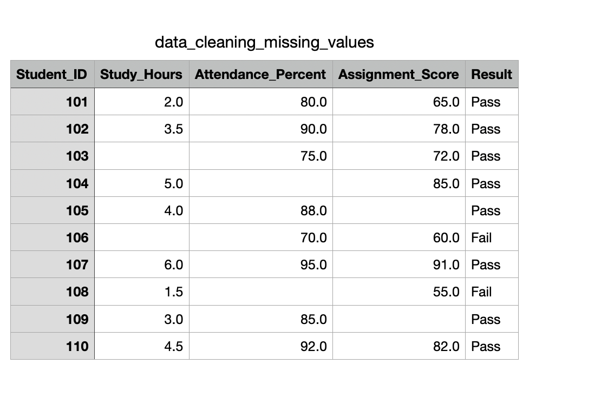
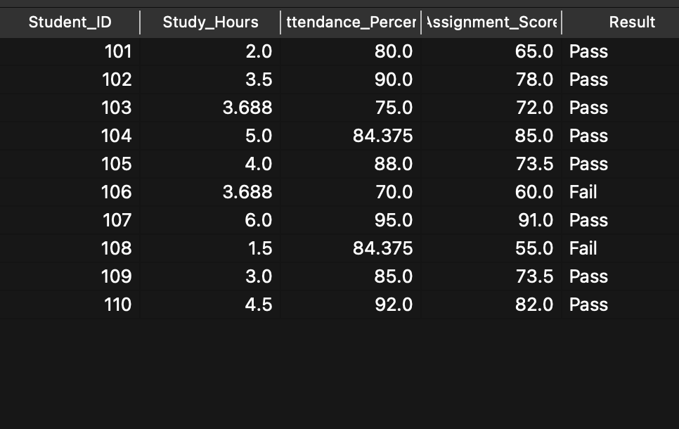

### 2. Data Reduction
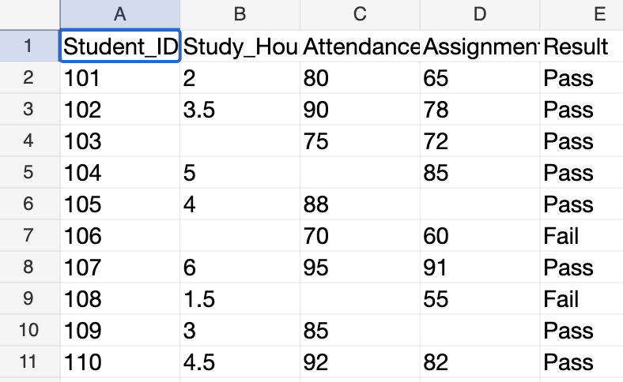
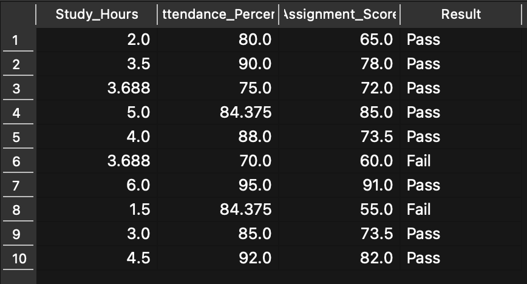

### 3. Data Transformation
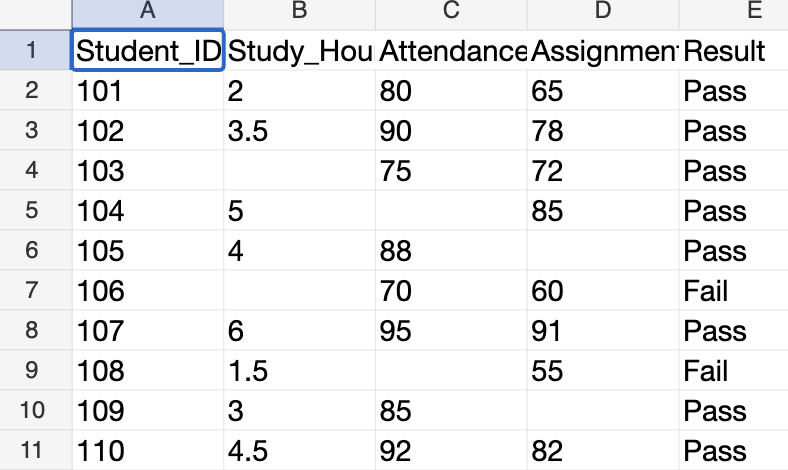
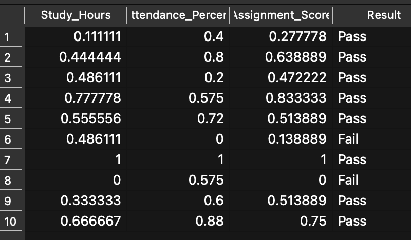

### 4. Association Rules — Apriori
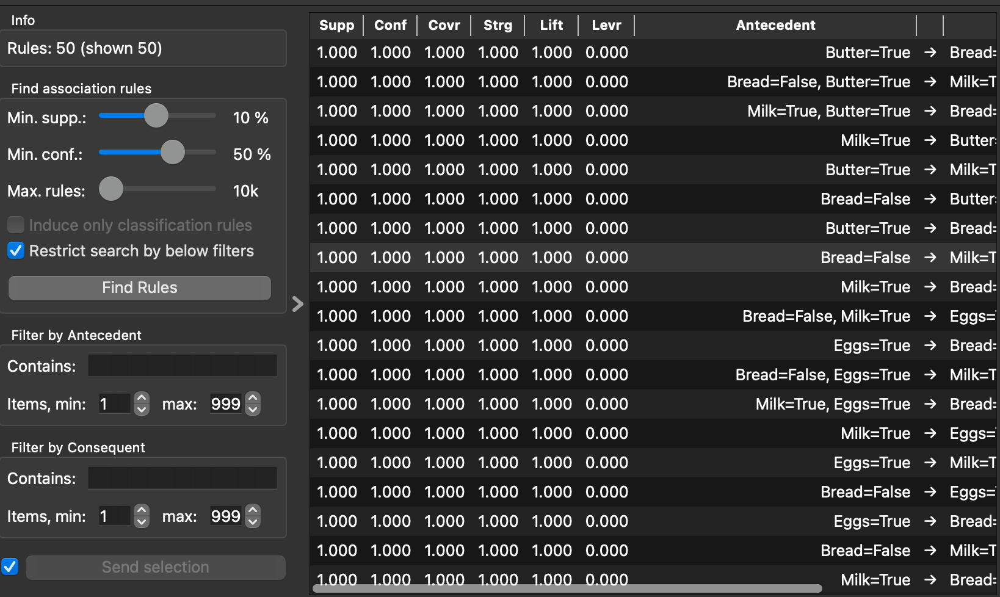

### 5. Statistical Analysis
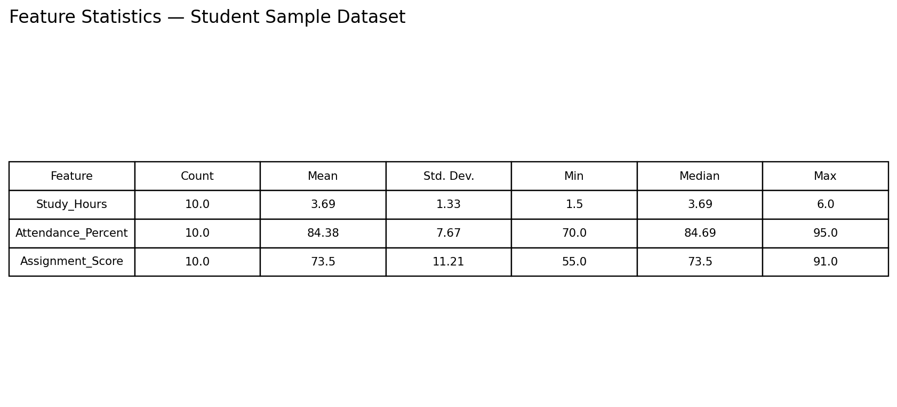

### 6. Regression
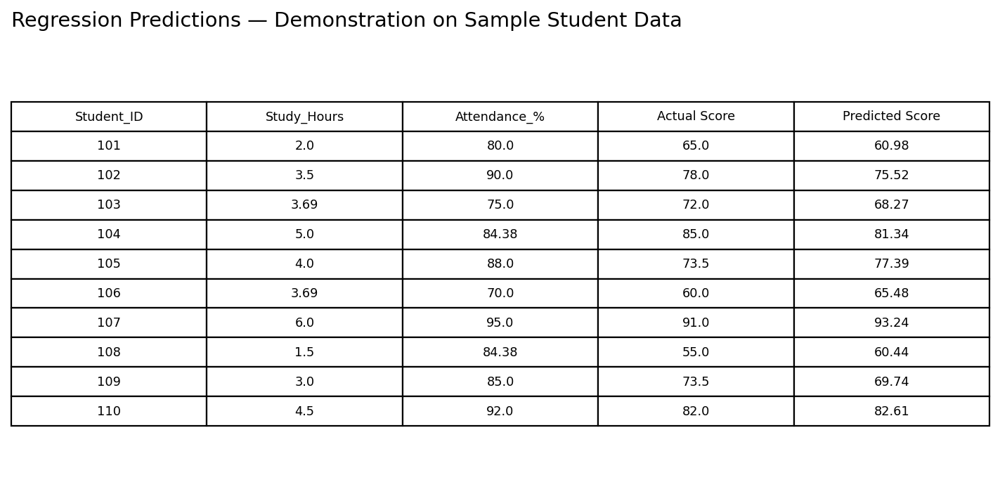

### 7. Outlier Analysis
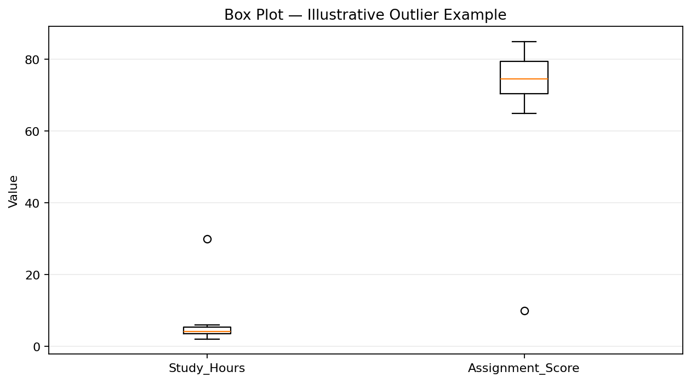

### 8. K-Means on Iris
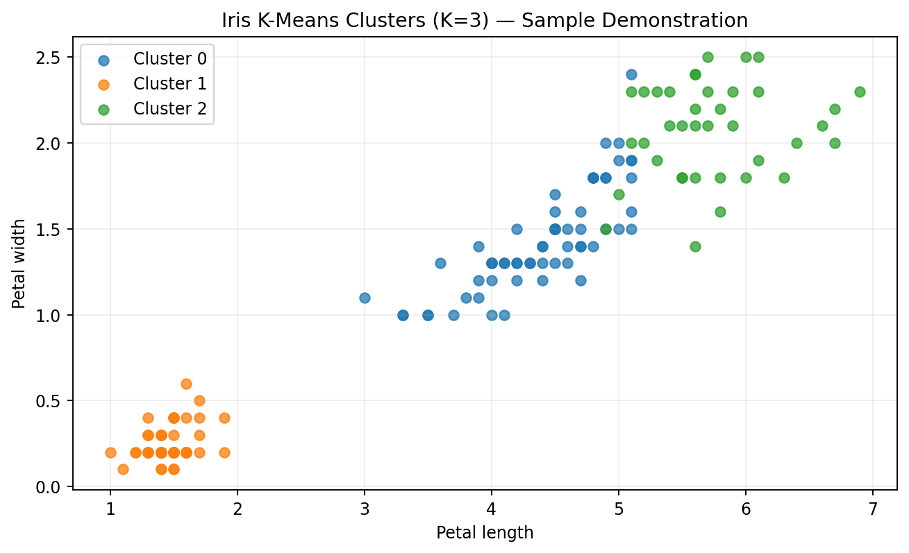

### 9. Clustering with Iris ARFF
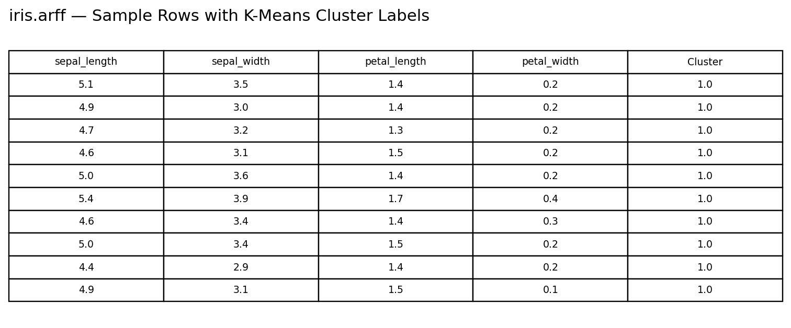

## Notes

- The `datasets/README.md` contains a summary of the experiment datasets and dataset-specific notes.
- `screenshots/full_pdf_pages/` contains page images from the assignment PDF for reference.
- Please verify the dataset files against your original source before final submission.
